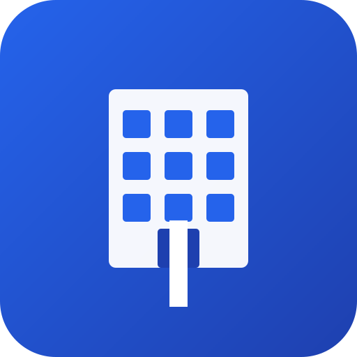

# Innovia Integrated Solutions - Android HTML Application

<div align="center">
  
  
  **A Progressive Web App (PWA) for Android Devices**
  
  [](https://www.android.com/)
  [](https://web.dev/progressive-web-apps/)
  [](https://developer.mozilla.org/en-US/docs/Web/Progressive_web_apps)
</div>

---

## 📱 About

Innovia Integrated Solutions is a mobile-optimized Progressive Web Application designed specifically for Android devices. This HTML-based application provides:

- **Call Center Software Solutions** - Advanced call center management with real-time monitoring
- **CRM Software Solutions** - Customer relationship management tailored to your business
- **Integration Solutions** - Seamless integration with third-party systems and APIs

## ✨ Features

### 🚀 Progressive Web App Capabilities
- **📲 Installable** - Add to Android home screen like a native app
- **🔌 Offline Support** - Works without internet connection using service workers
- **⚡ Fast Performance** - Optimized for mobile devices with caching
- **🌐 Bilingual** - Full support for English and Arabic with RTL layout
- **📱 Mobile-First Design** - Responsive UI optimized for touch interfaces
- **🎨 Modern UI** - Beautiful interface using Tailwind CSS

### 🎯 Android-Specific Features
- Standalone display mode (no browser UI)
- Status bar theming
- Touch-optimized controls (44px minimum)
- Smooth scrolling and transitions
- Pull-to-refresh support
- Install prompt for easy home screen addition

## 🛠️ Installation

### Option 1: Install as PWA on Android (Recommended)

1. **Open in Chrome Browser**
   - Visit the app URL in Google Chrome on your Android device
   - Example: `https://your-domain.com` or use a local server

2. **Install the App**
   - Tap the "Install" button when the prompt appears (usually after 3 seconds)
   - Or tap the three-dot menu → "Add to Home Screen"
   - Or tap "Install App" in the address bar

3. **Launch the App**
   - Find the "Innovia" icon on your home screen
   - Tap to open - it will run in standalone mode (fullscreen, no browser UI)

### Option 2: Development Setup

#### Prerequisites
- A web server (Apache, Nginx, or a simple HTTP server)
- Modern web browser (Chrome, Firefox, Edge)
- For Android testing: Chrome DevTools Remote Debugging

#### Local Development

1. **Clone the Repository**
   ```bash
   git clone https://github.com/your-username/innovia-android-app.git
   cd innovia-android-app
   ```

2. **Start a Local Server**
   
   Using Python:
   ```bash
   # Python 3
   python -m http.server 8000
   
   # Python 2
   python -m SimpleHTTPServer 8000
   ```
   
   Using Node.js:
   ```bash
   npx http-server -p 8000
   ```
   
   Using PHP:
   ```bash
   php -S localhost:8000
   ```

3. **Access the App**
   - Open your browser and go to `http://localhost:8000`
   - For Android testing: Use Chrome DevTools Remote Debugging

4. **Test on Android Device**
   - Connect your Android device via USB
   - Enable USB debugging in Developer Options
   - Open Chrome on your computer and go to `chrome://inspect`
   - Select your device and open the app URL

## 📂 Project Structure

```
/innovia-android-app
│
├── index.html              # Main application file
├── cms.js                  # Content management and localization
├── manifest.json           # PWA manifest for Android installation
├── service-worker.js       # Service worker for offline functionality
├── README.md              # This file
│
├── icons/                  # App icons for various resolutions
│   ├── icon.svg           # Scalable vector icon
│   ├── generate-icons.html # Icon generator utility
│   ├── README.md          # Icon generation instructions
│   └── icon-*.png         # PNG icons (generated)
│
└── .git/                  # Git repository
```

## 🎨 Customization

### Changing Colors

Edit the theme color in `manifest.json`:
```json
{
  "theme_color": "#2563eb",
  "background_color": "#2563eb"
}
```

And update the meta tag in `index.html`:
```html
<meta name="theme-color" content="#2563eb">
```

### Adding/Modifying Content

Content is managed in `cms.js`. To add or change text:

1. Open `cms.js`
2. Find the `content` object
3. Modify or add content for both `en` and `ar` languages
4. Add corresponding HTML elements with matching IDs in `index.html`

Example:
```javascript
const content = {
    en: {
        newSection: "New Section Title",
        newContent: "New content here"
    },
    ar: {
        newSection: "عنوان القسم الجديد",
        newContent: "المحتوى الجديد هنا"
    }
};
```

### Modifying the Icon

1. Open `icons/generate-icons.html` in a browser
2. Modify the canvas drawing code to change the icon design
3. Generate new icons by clicking "Generate All Icons"
4. Download and replace the icon files

## 🌐 Hosting Options

### Option 1: GitHub Pages (Free)
```bash
git add .
git commit -m "Deploy to GitHub Pages"
git push origin main
```
Then enable GitHub Pages in repository settings.

### Option 2: Netlify (Free)
1. Connect your GitHub repository to Netlify
2. Deploy with one click
3. Get a free HTTPS URL

### Option 3: Firebase Hosting (Free)
```bash
npm install -g firebase-tools
firebase login
firebase init hosting
firebase deploy
```

### Option 4: Self-Hosted
- Upload files to your web server
- Ensure HTTPS is enabled (required for PWA features)
- Configure your web server to serve the files

## 📱 Usage

### Language Switching
- Tap the "EN" or "AR" button in the header
- The app remembers your language preference
- Supports RTL layout for Arabic

### Navigation
- Use the top navigation menu (desktop)
- Tap the hamburger menu icon (mobile)
- Smooth scroll to sections by clicking links

### Offline Mode
- The app automatically caches resources
- Works without internet after first visit
- Updates automatically when online

### Installing on Android
1. Open the app in Chrome
2. Tap "Install" when prompted
3. Or use Chrome menu → "Add to Home Screen"
4. Find the app icon on your home screen

## 🔧 Technical Details

### Technologies Used
- **HTML5** - Semantic markup
- **CSS3** - Responsive design with Tailwind CSS
- **JavaScript (ES6+)** - Modern JavaScript features
- **Service Workers** - Offline functionality
- **Web App Manifest** - PWA installation
- **LocalStorage** - Persistent preferences

### Browser Support
- ✅ Chrome for Android (recommended)
- ✅ Firefox for Android
- ✅ Samsung Internet
- ✅ Edge for Android
- ⚠️ Safari (limited PWA support)

### Requirements for PWA Installation
- HTTPS enabled (or localhost for testing)
- Valid manifest.json file
- Service worker registered
- Icons provided in manifest
- Meets engagement heuristics (user interaction)

## 🐛 Troubleshooting

### App Won't Install
- Ensure you're using HTTPS (not HTTP)
- Check that manifest.json is accessible
- Verify service worker is registered (check DevTools)
- Clear browser cache and try again

### Offline Mode Not Working
- Check service worker registration in DevTools
- Ensure you've visited the app at least once while online
- Verify service-worker.js is accessible

### Icons Not Showing
- Generate icons using `icons/generate-icons.html`
- Ensure icon files are in the `/icons/` directory
- Check manifest.json paths are correct
- Clear browser cache

### Language Not Switching
- Check browser console for JavaScript errors
- Verify cms.js is loaded correctly
- Ensure element IDs in HTML match cms.js keys

## 📞 Contact & Support

For inquiries, support, or customization requests:

- **Email**: [info@innoviais.com](mailto:info@innoviais.com)
- **Website**: https://innoviais.com

## 📄 License

© 2023 Innovia Integrated Solutions. All rights reserved.

---

## 🚀 Quick Start Guide

**For End Users:**
1. Open the app URL in Chrome on your Android device
2. Tap "Install" when prompted
3. Launch from your home screen
4. Enjoy the app!

**For Developers:**
1. Clone the repository
2. Run a local web server
3. Open in browser or test on Android device
4. Customize as needed

---

**Made with ❤️ for Android**

Built using Progressive Web App technologies for the best mobile experience.
